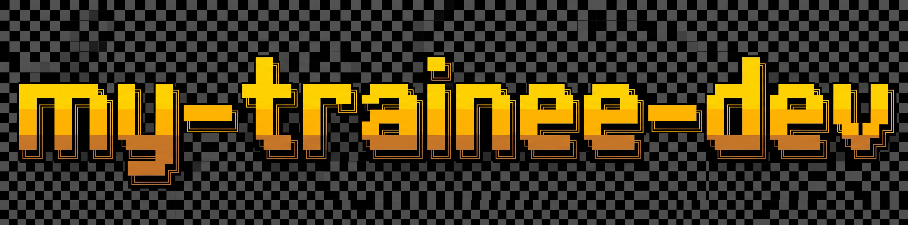

<p align="center">
  
</p>

Skill para o Claude que conduz o desenvolvimento de uma tarefa (feature ou bug) num projeto existente, do entendimento até o código pronto para review. Funciona com qualquer stack: os comandos de build, lint e testes são descobertos no próprio projeto.

Em vez de sair escrevendo código, o Claude segue um roteiro: entende a tarefa, pergunta o que estiver ambíguo, apresenta um plano, espera sua aprovação e só então implementa, testa e revisa.

O repositório também traz a skill [`maestro-qa`](#skill-maestro-qa), para testes E2E com o Maestro QA Dashboard.

## Como funciona

| Fase | O que acontece |
|---|---|
| 1. Contexto do projeto | Lê `CLAUDE.md` / `AGENTS.md`. Se não existirem, analisa stack, arquitetura e convenções. |
| 2. Entender a tarefa | Transforma a descrição em critérios de aceite. Lê as telas pelo Figma ou pelas imagens enviadas. |
| 3. Investigar o que existe | Mapeia telas, serviços e testes do fluxo. Classifica cada endpoint: atende, precisa de campo novo, precisa de nova versão ou precisa ser criado. |
| 4. Plano | Apresenta tasks, mudanças de API, testes previstos e riscos. **Nenhum código antes da sua aprovação.** |
| 5. Implementação | Uma task por vez, seguindo os padrões do projeto e rodando build, lint e testes a cada etapa. |
| 6. Teste no Maestro | Um subagente escreve e roda os flows no emulador ou dispositivo. Os flows são descartáveis e não ficam no repositório. |
| 7. Code review | Um subagente sem o histórico da conversa revisa o diff, para não ser influenciado pelas decisões já tomadas. |
| 8. Guia de review | Um resumo em português do que mudou, por onde começar a ler e como testar, para facilitar o review humano. |

Quando a tarefa é um **bug**, o fluxo muda: o Claude reproduz o problema antes de tudo, encontra a causa raiz, corrige com a menor alteração possível e escreve um teste de regressão.

### Regras que valem o tempo todo

- **Nunca inventa.** Regra de negócio, contrato de API ou comportamento de tela que não esteja na tarefa ou no código vira pergunta.
- **Trava de git.** Nunca faz commit, push ou PR sem pedido explícito. Cada pedido vale só para a ação pedida: aprovar o plano não autoriza commit, e pedir commit não autoriza push.
- **Subagentes não alteram código.** Eles só investigam, testam ou revisam. Toda alteração passa pelo agente principal.

## Instalação

### Claude (web e desktop)

**Pedindo ao próprio Claude (sem baixar nada).** Abra uma conversa e envie:

```
Instale esta skill na minha conta:
https://github.com/patricksantos/my-trainee-dev/blob/main/dev-task/SKILL.md
```

O Claude lê o arquivo e mostra um cartão para você revisar e salvar a skill.

**Pelo arquivo ZIP.** Baixe o [`dev-task.zip`](https://github.com/patricksantos/my-trainee-dev/releases/latest/download/dev-task.zip) e envie em Customize > Skills > + > Create skill > Upload a skill. Depois ative a skill na lista.

> Use o ZIP da página de releases. O botão "Download ZIP" do GitHub gera um arquivo com outra estrutura de pastas, que o Claude não reconhece como skill.

Nos dois casos, a execução de código precisa estar ativada nas configurações.

### Claude Code

**Com o [`skills`](https://github.com/vercel-labs/skills)** (precisa do Node.js 22 ou mais novo; confira com `node --version`):

```bash
npx skills add patricksantos/my-trainee-dev --skill dev-task -a claude-code -g
```

**Sem dependências**, baixando só o arquivo:

```bash
mkdir -p ~/.claude/skills/dev-task
curl -fsSL https://raw.githubusercontent.com/patricksantos/my-trainee-dev/main/dev-task/SKILL.md \
  -o ~/.claude/skills/dev-task/SKILL.md
```

**Ou peça ao próprio Claude Code:** "Instale a skill de https://github.com/patricksantos/my-trainee-dev em `~/.claude/skills/dev-task`".

Os comandos acima instalam para todos os seus projetos. Para instalar só em um projeto (e deixar disponível para o time que clonar o repositório), tire o `-g` do comando `npx` ou troque `~/.claude/skills` por `.claude/skills` dentro do projeto.

Para conferir, abra o Claude Code e digite `/dev-task`.

## Uso

Cole a descrição da tarefa e peça para usar a skill. No Claude Code, também dá para chamar direto com `/dev-task`:

```
/dev-task

Tarefa: permitir que o usuário edite o endereço de entrega no checkout.
Critérios: ...
Figma: https://www.figma.com/design/...
```

Se a tarefa tiver telas, envie o link do Figma (com as ferramentas do Figma conectadas) ou anexe as imagens. Para bugs, informe o comportamento atual, o esperado e os passos para reproduzir.

No fim, o código fica no working tree, sem commit. A partir daí você decide se quer pedir commit, push ou PR.

## Requisitos

- Para a fase 6: [Maestro](https://maestro.mobile.dev) instalado e um emulador ou dispositivo conectado. Sem isso, o Claude avisa em vez de simular resultado.
- Opcional: ferramentas do Figma conectadas, para ler as telas direto do link.

## Atualizar e remover

Para atualizar, rode de novo o comando de instalação (`npx skills add ...` ou `curl ...`). No Claude web e desktop, apague a skill antiga em Customize > Skills e instale a nova.

Para remover do Claude Code:

```bash
rm -rf ~/.claude/skills/dev-task
```

## Personalizar

As diretrizes do projeto (`CLAUDE.md` / `AGENTS.md`) têm prioridade sobre a skill. Por isso, o jeito mais simples de adaptar o fluxo ao seu time é registrar ali os comandos, padrões e convenções do projeto. Para mudar o fluxo em si, faça um fork e edite `dev-task/SKILL.md`.

## Skill maestro-qa

Explora telas com o Maestro MCP, grava os fluxos YAML em `.maestro/flows/` do app e executa as suítes pelo Maestro QA Dashboard, conferindo o resultado pelo JUnit. Não faz commit, compra, transação nem ação destrutiva sem autorização.

As duas skills são independentes: a dev-task valida cada entrega com flows descartáveis, e a maestro-qa cuida da suíte de regressão permanente, só quando você pedir.

A skill usa como apoio o Maestro QA Dashboard, que vem dentro da própria skill, em [`maestro-qa/maestro-qa-dashboard`](maestro-qa/maestro-qa-dashboard). Instalando pelo `npx skills`, o dashboard é copiado junto.

Requisitos:

- Node.js 22.13 ou mais novo, para o dashboard. Com o nvm: `nvm install 22 && nvm alias default 22`.
- [Maestro CLI](https://docs.maestro.dev) instalado, com o servidor MCP registrado no Claude Code para todos os projetos: `claude mcp add -s user maestro -- maestro mcp`. Sem o `-s user`, o MCP só vale na pasta onde o comando foi rodado.
- Um emulador, simulador ou dispositivo com o app de debug instalado.

Instalação no Claude Code:

```bash
npx skills add patricksantos/my-trainee-dev --skill maestro-qa -a claude-code -g
```

## Licença

[MIT](LICENSE). Pode usar, alterar e redistribuir, mantendo o aviso de copyright.
